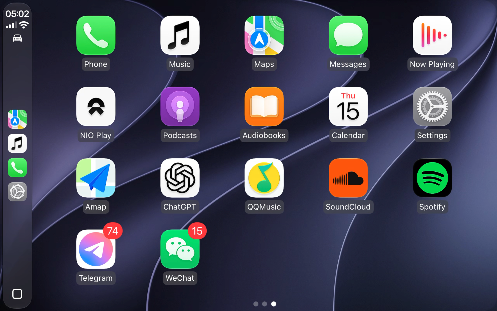

<h1 align="center">NIO Play</h1>

<p align="center">iPhone → Mac → 车机浏览器：一个把 CarPlay 串流到蔚来车载大屏的浏览器里显示和操作。</p>

<p align="center">
  <a href="LICENSE"></a>
  <a href="#使用条件"></a>
  <a href="https://github.com/kissggj123/NIOPlay/releases"></a>
</p>

<p align="center"><a href="#快速入门">快速入门</a> · <a href="#音频与麦克风">音频跟随</a> · <a href="#浏览器端">浏览器端</a> · <a href="#从源码构建">源码构建</a> · <a href="#致谢">致谢</a></p>

<p align="center"></p>

## 这是什么

本仓库是 [MacPlay](https://github.com/Roylyl/MacPlay) 的 fork（因为是蔚来车主且没有安卓机），目标只有一个场景：**把 Mac 变成 CarPlay 接收器，再把画面串流到蔚来车机/任意平板的浏览器**。

```
iPhone --(USB/无线 CarPlay)--> Mac --(局域网 http://<Mac-IP>:8080)--> 浏览器
```

Mac、iPhone、显示端在同一局域网（通常是车机/手机热点）。Mac 负责与 iPhone 建立 CarPlay 连接并解码，浏览器只负责显示画面、回传触控、播放声音——显示端零安装，打开浏览器即可。

## 快速入门

### 使用条件

- macOS 14 及以上，Apple Silicon（M 系列）处理器。目前仅提供 ARM64 构建，Intel 机型需自行从源码编译。
- 支持 CarPlay 的 iPhone；有线需要 USB 数据线，无线需要蓝牙与允许设备互访的共用 Wi-Fi。
- 任意设备浏览器（车机 / iPad / Mac），与 Mac 在同一局域网。

### 安装与启动

从 [Releases](https://github.com/kissggj123/NIOPlay/releases) 下载 `NIOPlay-*.dmg`，拖入"应用程序"后启动。若 macOS 拦截，在"系统设置 → 隐私与安全性"中允许打开（本地签名，未经 Apple 公证）。

或从源码构建：

```sh
git clone https://github.com/kissggj123/NIOPlay.git
cd NIOPlay
pnpm install
bash scripts/build-macplay.sh --arch=arm64
```

### 连接 iPhone

1. **有线**：USB 连接 iPhone 与 Mac，解锁并"信任此电脑"，点击"启动接收"。
2. **无线**：Mac 与 iPhone 加入同一 Wi-Fi，蓝牙配对，在"连接 → 共用 Wi-Fi"填写 SSID 与密码（首次可一键读取钥匙串已存密码），点击"启动接收"，在 iPhone 上允许 CarPlay。

### 打开车机浏览器

在设置页复制局域网地址，在车机浏览器打开：

- `https://<Mac-IP>:8443` — WebRTC 直通实时画面（推荐，首次访问点一次"继续前往"信任自签证书）
- `http://<Mac-IP>:8080` — MJPEG 兼容画面（不支持 WebCodecs 的老旧车机浏览器使用，可在设置关闭以节省 CPU）

两个端口都支持 HTTP/HTTPS 自动识别，无需手动加前缀。

## 音频与麦克风

音频模型为**纯浏览器跟随**，Mac 永远只是中继、不本地出声：

- **哪台设备开浏览器，哪台出声**——车机开就车里响，iPad 开就 iPad 响。
- **谁都没开浏览器 = iPhone 暂停播放**，与蓝牙耳机断开的语义一致（通过 CarPlay 媒体 HID 键实现，Mac 不输出任何声音）。
- 新增设置「**打开浏览器时自动恢复播放**」（默认开）；关闭后接入浏览器仅接通声音通道，播放/暂停完全由你在车机上手动控制。
- **麦克风同样跟随浏览器**：Siri 与通话使用显示端的麦克风，浏览器断开后自动回落 Mac 麦克风。

## 浏览器端

- **画面自适应**：页面加载时按窗口物理像素协商一次流分辨率，之后窗口任意缩放均为 CSS 无级缩放（适应/填充两种模式，「填充」为播放器全屏式裁切铺满），不会触发重连。
- **视频**：优先 WebRTC 直通（捆绑 GStreamer `webrtcbin`，零转码、延迟最低），不支持时回退 WebCodecs 硬解（H.265/H.264 自动识别）；MJPEG 兜底流永不黑屏。
- **音频**：CarPlay 各路音频解码后 PCM 并帧为 20ms 块经 WebSocket 直发浏览器，AudioWorklet 环形缓冲渲染——自适应深度、欠载消喀哒、48kHz 流式重采样，主线程卡顿免疫；媒体/导航/通话各流独立。
- **显示参数由车机决定**：请求分辨率按车机窗口像素、屏幕物理宽度档位（消除 iOS 布局黑边）都在网页「显示」设置内调整，**按设备记忆，Mac 仅中继**。
- **控制**：多点触控回传、键盘方向键 = 旋钮、全屏按钮（车机内核不支持全屏接口时自动降级沉浸模式）；状态 HUD 可在设置里显示/隐藏。

### 其他特性

- **WiFi 密码一次授权终身免输**：读取钥匙串成功后自动缓存到本地网络配置，网络切换自动填入（App 更新重签不再导致钥匙串授权失效）；授权弹窗引导点「始终允许」。
- **无头模式**：Mac 上不显示 CarPlay 窗口，画面只在浏览器。
- **连接时防止系统休眠**：CarPlay 会话期间自动 `caffeinate`，断开自动释放（合盖熄屏为 macOS 硬件行为）。
- **实时日志控制台**：nginx 风格自动滚动，支持清空/导出。
- CarPlay 主屏与 Dock 显示 NIO 品牌图标。

## 原生功能（继承自上游）

- USB 直连 / 共用 Wi-Fi 无线连接，蓝牙引导配对。
- 帧率配置（30/60/90/120fps，高帧率协商失败自动回退）；分辨率由车机浏览器上报决定。
- 无线被动断开自动重连、USB 接入自动启动、菜单栏常驻后台运行。
- 跟随系统 / 简体中文 / 繁體中文 / English 四种界面语言。

## 常见问题

| 现象 | 处理方法 |
| --- | --- |
| 浏览器打不开页面 | 确认与 Mac 同一局域网；复制设置页的地址；检查 macOS 防火墙是否放行 TCP 8080/8443 |
| 有画面没声音 | 声音只在浏览器播放（Mac 本地无声是设计如此）；确认浏览器已允许自动播放/取消静音 |
| 没开浏览器但 iPhone 还在响 | 约 1.5 秒后自动暂停（HID 键生效延迟）；若未暂停请重启接收 |
| 车机画面有黑边 | 网页「显示」→ 缩放模式选「填充」消除页面黑边；若画面内仍有边距，调整「屏幕物理宽度」档位（默认 200mm，依次试 175/225/250），每次改完重启接收 |
| 停止接收后画面残留 | 自动断流并显示「已断开」，重启接收后无需刷新自动恢复 |
| 合盖后断开 | macOS 限制：合盖持续运行需连接电源，并开启"连接时防止系统休眠" |

## 致谢

- **[MacPlay](https://github.com/Roylyl/MacPlay)**（Roylyl）：完整的 macOS CarPlay 主机实现（USB/无线传输、GStreamer 音视频管道、SwiftUI 界面）。本项目是其 fork，核心连接与解码能力全部来自上游。
- **[WheelPlay](https://github.com/fython/wheelplay)**（fython）：浏览器音频二进制 PCM 协议与触控坐标映射思路。
- **[PlayPort](https://github.com/youcci/playport)**（youcci）：WebCodecs 零转码直通架构等设计。
- 上游依赖：[LIVI](https://github.com/f-io/LIVI)（CarPlay 协议基础）、[DiPlay](https://github.com/shihabal3amri/DiPlay)。

## 许可

沿用上游 GPL-3.0-or-later，见 [LICENSE](LICENSE)；运行库许可位于 `assets/licenses` 与 `assets/gstreamer/LICENSES`。上游版权与来源声明见 [NOTICE](NOTICE)。

第三方组件、认证文件和商标分别适用各自权利条件。本项目是独立 fork，不代表 Apple、上游作者或蔚来（NIO），不声称获得 MFi 认证。分发修改版时应保留声明并提供适用许可证要求的对应源码与构建资料。
